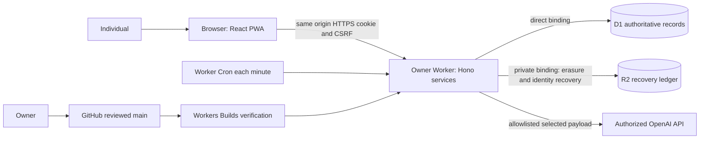
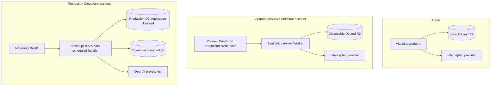

# Reflection — proposed architecture, revision 2

Prepared 2026-10-26. **Specification only. No application, hosted infrastructure, model qualification, live migration, or deployment has been implemented or proven.** “Reflection” is a neutral working name. The three predecessors are retired as foundations by owner decision.

Revision2 resolves the review of e505ca3: database-clock deadline eligibility, independent encrypted erasure targets and completion revisions, explicit import source/recovery identity, and bounded history previews. These are refinements to the pre-implementation v1 contracts; the architecture and milestone scope remain as specified.

## Reading order and authority

1. This file: scope, constraints, decisions, boundaries, evidence, unknowns.
2. [DOMAIN_CONTRACTS.ts](DOMAIN_CONTRACTS.ts): authoritative Zod wire/domain schemas and service types; [openapi.yaml](openapi.yaml) is its generated HTTP projection.
3. [schema.sql](schema.sql), [DATA_LIFECYCLE.md](DATA_LIFECYCLE.md), [COLUMN_REGISTRY.json](COLUMN_REGISTRY.json): D1 storage and field coverage.
4. [GENERATION.md](GENERATION.md): state transitions, assertions, races, composition and accounting.
5. [PRIVACY_OPERATIONS.md](PRIVACY_OPERATIONS.md), [SECURITY_RESTORE.md](SECURITY_RESTORE.md), [USER_EXPERIENCE.md](USER_EXPERIENCE.md): security, lifecycle, release controls and journeys.
6. [ASSETS_AND_MIGRATION.md](ASSETS_AND_MIGRATION.md), [VERIFICATION_PLAN.md](VERIFICATION_PLAN.md), [IMPLEMENTATION_PLAN.md](IMPLEMENTATION_PLAN.md).
7. [CHECK_RESULTS.md](CHECK_RESULTS.md): actual local checks and review disposition, distinct from proposed tests.

Owner instructions outrank this package. The supplied brief outranks predecessor documentation. Types own field names; SQL owns persistence constraints; GENERATION owns transition policy; PRIVACY_OPERATIONS owns security/retention; API descriptions add operation-specific rules without redefining schemas. Proposed code paths below do not yet exist. Disposable evidence and artifact checks live outside the proposed application.

## Inputs and evidence status

| Input | Access and inspection |
|---|---|
| Attached `pasted-text-2.txt` | Read in full; task authority. |
| T-A `henryperkins/tarot@73d36ac8cbb9fbf65e8c3bd7e6dd1ad4c3cfe653` | Tree and selected implementation, tests, asset manifests, editorial reports read through GitHub. |
| T-B `henryperkins/tarot@23e4a920e661e3b1709e7b83cbaefa5f4980e70c` | Pointer supplied; not inspected. No assertion about its ordering or equivalence to T-A. No selected decision depends on their difference. |
| P `henryperkins/patternlike-app@b84c4aa09384a668f4dcc74256d43d5192139911` | Selected schema, crypto fence and focused tests, deletion manifest, export and licensing material read. |
| X `henryperkins/pixel-perfect-view-757@6367af13ab646e5b8f7829a3c51e1504696da0ab` | Selected facts, composition, context eligibility, content activation and privacy tests read. |
| [Shared ChatGPT session](https://chatgpt.com/share/6aded2cf-d3b8-83ea-8ca6-d40a37f321ea) | Fetch produced title but no conversation text; unreadable, not relied upon. |
| [Claude Code session](https://claude.ai/code/session_019apW3255eMk1f66ourff4J) | Fetch unavailable; not read. |
| `Successor_Product_and_Architecture_Synthesis.md` | Not supplied in workspace or located by focused inspected tree search. No claims attributed to it. |
| Production records, subscriptions, deployment configuration, live credentials | Not accessed; not required to write this package. |

Research copies are read-only evidence under `../../research`, never product foundations. Source tests were **read, not executed**. A report's claimed pass remains a historical report, not a new result. The local checks in CHECK_RESULTS apply only to the proposed artifacts and synthetic data.

## Confirmed constraints

C01 new strict TypeScript; C02 owner-controlled Cloudflare Worker and direct D1 bindings; C03 one origin, secure cookie; C04 D1 authoritative; C05 GitHub, no GitHub Actions; C06 authorized service API for production inference; C07 one operator assisted by coding agents; C08 no predecessor adoption; C09 no real-data work, paid inference or hosted changes in this task. Every working default is retained. The authentication, model, recovery and retention choices below resolve open defaults; they do not assert business facts.

## Product hypotheses, scope and requirements

Audience assumption: English-speaking individuals who want a private reflective exercise. Tarot is an interpretive tradition, not evidence of events or a diagnostic instrument. A concise reading is an invitation to respond, including disagreement. No claims about market size, current users or willingness to pay.

Hypotheses: H1 inspecting the basis improves understanding without creating false certainty; H2 separately authored reflections preserve agency; H3 returning to an unchanged reading helps people notice changes; H4 explicit context selection makes follow-ups useful without unwanted memory. Evaluate H1–H4 separately from correctness and editorial quality. The primary journey is begin → read → inspect → write → save → reopen/update.

| ID | Requirement and enforceable acceptance | Scope |
|---|---|---|
| R01 | Authenticated, owner-scoped records from first persistence; foreign-owner reads are 404; composite FKs reject cross-owner links. | Slice |
| R02 | One three-card RWS-identity spread, no replacement, exact position/orientation snapshots, code-rendered facts. | Slice |
| R03 | Fully validated result only; progress never contains candidate prose. Immutable accepted text is reopened without inference. | Slice |
| R04 | Separate reflection revisions; explicit confirmed save, conflict-safe update, disagreement preserved. | Slice |
| R05 | Distinct storage, model permission, per-source eligibility, selection, actual egress; current guards at dispatch and publication. | Slice; selection UI v1 |
| R06 | Idempotent starts, unique publication, bounded work, cancellation, uncertain execution and cost accounting. | Slice |
| R07 | Export and erasure, key rotation, restore erasure replay, no private offline caches. | Slice |
| R08 | Exact content/source/prompt/validator/provider identity; semantic limits disclosed. | Slice |
| R09 | Accessible mobile web/PWA and safe interruption/recovery; WCAG 2.2 AA journey checks. | Slice |
| R10 | History and intentional revisits; follow-ups name exact parent and selected transmitted fragments. | Completed v1 |
| R11 | Versioned import, preview, exact old text and explicit provenance gaps; no implicit generation grant. | Completed v1 |
| R12 | Hosted deterministic deployment gate under ten minutes target; isolated previews and fail-test proof before real users. | Slice |
| R13 | Quotas, conservative provider-spend reservations, content-free telemetry and incident procedures. | Slice |
| R14 | Sensitive-topic/language outcomes and false-positive handling; no ordinary fallback for disallowed input. | Slice |
| R15 | Content rights/approval gates and withdrawal/correction handling; no invented human approval. | Slice |
| R16 | Typed later astrology boundary with uncertain time and licensing gates; no astrology execution in v1. | Later contract only |
| R17 | All changes versioned together; registry detects private fields without export/erasure policy. | Slice |

First slice includes identity/recovery, permission, limits, reading/basis, saved reflection, exact reopening, deletion and export, even in a small private rollout. Until those are ready all prototypes use synthetic local data and an intercepted provider. Completed v1 adds history, revisits, selected-context follow-ups, and selected imports. Later: astrology, MCP, billing, richer coaching, check-ins, narration, recognition, Time Travel, astrocartography and portraits. No shared accounts, reader practice management, collaboration, journal search, embeddings, automatic biography or silent memory.

## Proposed budgets, not measurements

Planning envelope: **100 active accounts**, 1,000 generation starts/month, 100,000 dynamic requests/month including polling, 2 simultaneous starts/second for brief bursts, at most 10 active provider dispatches, 2,000 sessions/account, 20 MiB encrypted personal data/account, 1 GiB total D1 planning usage. These are sizing assumptions, not discovered demand. Admission stops at account/storage limits with export available; increase only after a measured index/storage/load review.

| Dimension | Proposed target, limit and measurement |
|---|---|
| API | p95 start/save/reopen <1 s; p99 <2.5 s, excluding client network. Record duration histograms by route template, never IDs/text. |
| Reading | p95 accepted model result <25 s; 18 s provider timeout, 25 s fast-driver budget. Recovery target <120 s after lost wake; request absolute expiry 180 s. Qualify with representative prompts/regions. |
| Availability | 99.5% monthly availability for owned saved-record read/write; generation availability tracked separately. No implied provider SLA or 24/7 staffed response. |
| Recovery | RPO ≤5 minutes for database incident, RTO ≤4 operator hours after detection; prove with synthetic staging restore before launch. Cloudflare Time Travel is a dependency, not an independent backup. |
| Privacy | Immediate logical fence when deletion/revocation commits; active-store erasure target ≤24 h; documented backup window ≤30 days plus erasure ledger retained 45 days after completed erasure; pending intents never expire. |
| Cost | Normal generation ≤$0.03 expected at 4k input/1.6k output; hard reservation $0.04/dispatch at ≤8k input and ≤1.6k output, assuming current pricing. Global $10/day and $100/month limits. |
| Quota | 3 accepted model readings/day and 30/month/account, UTC periods. Template results release quota. At most 2 active requests/account; 10 globally dispatching. |
| Content | 3 interpretive units, each ≤650 characters plus ≤200-character question; closing ≤250; ≤500-word rendered experience including code facts. |
| Accessibility | WCAG 2.2 AA, 320 CSS px and 200% text without lost functions; 44×44 CSS px target controls; keyboard and VoiceOver/NVDA manual gates. |
| Verification | Repository gate p95 ≤8 minutes, abort locally at 9 minutes; hosted Builds hard timeout currently 20 minutes. No live inference in this gate. |

Product study proposal: opt-in synthetic/usability sessions first, then explicit participant consent; 8–12 participants is a qualitative starting sample, not a power calculation. Ask readers to distinguish fact/source/interpretation, author a response, and explain a revisit after 7–14 days. Record whether authorship remained separate, whether disagreement felt safe, and whether revisiting was useful; no journal-content analytics. Proposed signals: ≥80% correctly distinguish evidence roles, ≥70% complete save/reopen unassisted, ≥60% of consenting participants report a useful revisit. Failure changes the journey/editorial approach, not safety thresholds. Never infer willingness to pay from usage alone.

## System and deployment boundaries

No public database proxy, client D1 access, external auth vendor, Queue, Workflow, Durable Object, KV, separate calculation runtime or artifact service in v1. D1 request rows are the durable work queue. `waitUntil` is an opportunistic low-latency wake, not durability. A one-minute Cron scans indexed due work, with leases and three bounded local attempts. If timing qualification fails, the specific reconsideration is a Queue consumer while retaining the same D1 requests and publication guards; it is not an undisclosed dependency.

R2 is justified for erasure intents and encrypted identity checkpoints that must survive D1 rollback. It holds no journal, prompts, export bodies, raw bearer credentials or account encryption keys. The bounded security-operation saga and restore reconsent/financial fence are specified in SECURITY_RESTORE. There is no D1/R2 transaction: deletion is a fenced, retryable saga. R2 failure blocks final deletion acknowledgement, not unrelated reflection saves. See PRIVACY_OPERATIONS.

| Component / planned location | Responsibility and interface | Dependencies, limits, failures |
|---|---|---|
| `src/contracts/index.ts` | Move the authoritative schemas here; infer TypeScript; generate API/JSON Schema. | Zod only; no server secrets; incompatible versions rejected. |
| `src/client/` | Routes, accessible forms, memory-only drafts and query cache. | Contracts and same-origin API; never DB/provider; offline is explicit. |
| `src/worker/http/` | Hono routing, body limits, schema parsing, origin/auth/error mapping. | Services, not raw SQL; ≤256 KiB ordinary body, special import limit 2 MiB. |
| `src/worker/identity/` | SimpleWebAuthn verification, challenges, recovery and sessions. | Web Crypto + D1; five-minute challenges, ≤10 credentials; fail closed only identity-dependent routes. |
| `src/worker/services/` | Ownership and transactional business rules; HTTP/MCP-independent Principal. | Repositories, crypto, domain, provider interface; no arbitrary network fetch. |
| `src/worker/db/` | Prepared statements, assertion batches, migrations and primary reads. | Direct D1 binding; no transaction spanning await/network; query/statement budgets. |
| `src/domain/tarot/` | Draw, facts, plan, mechanical checks and deterministic composition. | Contracts + approved canon; no persistence/network. |
| `src/domain/validation/` | Bounded syntax/claim analysis and verdict codes. | Plan + candidate; no model calls; heuristic limits disclosed. |
| `src/worker/provider/openai.ts` | One permitted Responses call and exact egress receipt. | OpenAI key, policy manifest; 18 s, no tools/retries; uncertain result remains costly. |
| `src/worker/jobs/` | Fast driver, Cron claims/recovery/retention/deletion. | Same services/repositories; 20 jobs/run, 4 concurrent local tasks, no independent truth. |
| `src/worker/recovery/` | Identity checkpoint/erasure sagas and offline restore replay. | Direct D1/R2 bindings and RECOVERY_KEK; serialize security operations with D1 fences; missing ledger blocks restore/security completion. |
| `src/worker/crypto/` | AES-GCM envelopes, AAD, key wrapping and write fences. | Worker KEK secrets + D1 wrapped DEKs; key failure isolates affected accounts. |
| `content/` | Immutable reviewed bundles, rights, deck and deterministic text. | Owner review + hashes; withdrawal beats reproducibility. |
| `scripts/` | Verify, release wrapper, schema projections, content activation and operator checks. | Locked dev dependencies; no production data during verify. |
| `tests/` | Deterministic fixtures and fault schedules. | Intercept all provider/network calls; synthetic only. |

One npm project, one lockfile, TypeScript `strict`, `noUncheckedIndexedAccess`, `exactOptionalPropertyTypes`, Hono, React, Vite, Zod 4. Pin exact versions at milestone 1 after compatibility test; exact package patch versions are external resolution inputs, not substitute architectural choices. Vitest plus Cloudflare Workers pool for D1 binding tests; Playwright and axe for client checks; SQLite for fast migration/constraint checks. No independent shared-package release regime. Module boundaries follow trust/transaction/domain responsibility, not arbitrary line counts.

Generate `openapi.yaml` and provider JSON Schema from Zod. Model schema uses a separate explicitly limited projection (`ModelCandidate`), not the entire domain union. Strip only unsupported validation keywords for the provider projection, with a manifest and locally stricter validation; never weaken local constraints. Schemas are closed objects. A checked fixture proves generated schemas and local parsing agree. API v1 tolerates additive response fields only after generated client update; inputs reject unknown fields. Breaking payload changes require `/api/v2`; accepted schema decoders remain until data migrates or is erased.

## Compact decision log

| ID / requirement | Selected approach and rationale | Tradeoff / rejected alternative / reversal and revisit |
|---|---|---|
| D01 / C01–04,R01 | One Worker, Hono/React/Vite/Zod, primary D1, single repo. Fits operator and ownership transaction needs. | Global DB round trips; reject generic HTTP SQL proxy. Moderate repository-layer change if measured latency/scale breaches budget. |
| D02 / R06 | D1 leases + waitUntil fast wake + Cron recovery. Durable truth remains in one DB. | Recovery can add a minute; reject DO/Queue initially. Add Queue only if timeout/latency proof fails; requests/guards unchanged. |
| D03 / R01,R07 | Passkeys using maintained SimpleWebAuthn server/browser, own opaque cookie, recovery codes. | No email recovery; losing all factors loses access. Reject passwords/email vendor dependency. Moderate auth adapter migration; workerd/browser proof blocks real users. |
| D04 / R05,R07 | Server-readable per-account envelope encryption. | Worker/owner can decrypt; reject client-only because selected generation/recovery/exports need server access. High reversal cost; revisit if end-to-end encryption becomes a product requirement. |
| D05 / R03,R08 | Code-render precise facts; model writes bounded interpretation/questions, never placeholders. | Less fluid technical prose; reject universal tokens and unconstrained fact prose. Moderate schema/prompt change if offline qualification shows structured assertions read better with equal safety. |
| D06 / R06,R13 | One OpenAI `gpt-5.6-terra` request, reasoning none, structured output, no provider retry. | Timeout may waste spend and yield a template. Reject subscription runners, cross-provider failover and quality chains. Low adapter cost but full requalification on model change. |
| D07 / R03 | Progress polling then accepted result; no prose streaming. | Less apparent immediacy; reject unvalidated partial prose. Moderate client/protocol change only after a measured user requirement. |
| D08 / R07 | R2 recovery ledger independent of D1 restoration. | Small second store and saga; reject relying on a tombstone inside the restored DB. Moderate replacement cost; retain property under any backup redesign. |
| D09 / R12 | Workers Builds main-only production, repository release wrapper, separate preview account. | Owner can bypass; deployment is not merge enforcement. Reject GitHub Actions unavailable by constraint. Low CI portability cost if hosted fail-test proof fails. |
| D10 / R15 | New minimal human-approved canon; selectively transform old material with exact review/rights status. | Editorial launch work; reject equating agent review with approval. Low content implementation cost, requalify every edition. |
| D11 / R10,R11 | Exact immutable versions and explicit excerpts; legacy records display as unverified. | More visible context controls; reject automatic memory and provenance reconstruction. High semantic/privacy reversal cost. |
| D12 / R13 | Free quotas and spend ceilings; billing adapter disabled. | No monetization in v1; reject checkout/webhooks now. Future entitlement implementation behind existing allowance interface. |

## Provisional decisions and bounded unknowns

Chosen architecture can be coded now; **qualification is not optional launch paperwork**. Unknown external values use environment placeholders with startup validation, never fabricated IDs.

| Item / category | Dependencies and bounded resolving check | Blocks |
|---|---|---|
| Model writing quality, latency, actual token use (provisional D06) | Frozen 240-case balanced corpus, up to 720 calls, $40 hard evaluation cap; gates in VERIFICATION_PLAN. No evaluation run here. | Provider activation/real-user launch, not local contracts. |
| Passkey workerd compatibility (provisional D03) | Pinned SimpleWebAuthn verification in Cloudflare test pool, platform/cross-device passkeys on iOS/Android/desktop and recovery exercise. Docs describe Node/Deno, not a guarantee for this Worker. | Real identity rollout. If incompatible, first adapt documented Web Crypto usage; redesign auth only by recorded ADR. |
| Hosted release isolation/enforcement | Actual configured main and preview builds with intentional failing test, attempted non-main deploy, synthetic resource markers; inspect token privileges. | First real-user slice. |
| Current/legacy users and subscriptions (business unknown) | Owner-supplied inventory by project and provider, read-only reconciliation separately authorized; branch retirement plan. | Retirement, not new app coding/launch. |
| Asset/canon rights and exact human approvals (business unknown) | Per selected asset hash/source/territory evidence; owner reviews exact launch bundle. Text card presentation works without art. | Affected content/art launch; not architecture. |
| Target jurisdiction, adult/minor audience and crisis contact regions (business unknown) | Owner states initial geography/age policy; review privacy wording/retention/crisis copy for it. Working technical posture: adults-only invitation pilot; not an asserted legal requirement. | Public launch; synthetic coding unaffected. |
| Cloudflare account/region/domain, RP ID and runtime compatibility date | Read configured resource inventory during implementation; set exact origin/RP and worker compatibility date, prove restore. Domain must be stable before registering real passkeys. | Real identity/production, not local harness. |
| Provider account access, retention settings and financial ceiling authority | Confirm project key, model access, no-training defaults, contractual retention and billing limits without generating text; owner adopts or revises proposed $100/month cap. | Provider egress; privacy remains fail closed. |
| Product benefit/continuity (hypotheses) | Consented study described above; no invented telemetry baselines. | Broader rollout decisions, not first bounded pilot. |
| Swiss Ephemeris licensing/engine (later unknown) | Exact dependency/license inventory and precision/uncertainty tests before adding method. | Astrology only. |

## Source ledger: exact claims and limits

All platform pages consulted on 2026-10-26. Links establish documented capability, not configured behavior or account entitlement. Local full source copies support the following narrow observations.

| Evidence | Observed statement and design use |
|---|---|
| `henryperkins/tarot@73d36ac8cbb9fbf65e8c3bd7e6dd1ad4c3cfe653:src/lib/deck.js:14` and `:src/lib/deck.js:289`; `:tests/deck.test.mjs:11` | Source uses rejection sampling in browser crypto shuffle, has a Math.random fallback and separate orientation randomness; tests include seeded equality. New design retains unbiased shuffle idea, removes weak random fallback and versions the full draw. |
| T-A `functions/lib/readingCardAssertions.js:19`, `:95`; `tests/readingCardAssertions.test.mjs:1` | Source distinguishes reported quotation and some negative assertions; tests exercise these cases. Useful corpus seeds, not a complete semantic verifier. |
| T-A `docs/knowledge-graph/READING_PIPELINE_EDITORIAL_REVIEW.md:3`, `:7`, `:215` | Report distinguishes mechanical checks and agent verdicts; no missing human metadata becomes approval. Treat its counts as report claims. |
| T-A `docs/knowledge-graph/READING_PIPELINE_NARRATIVE_REVIEW_2026-10-24.md:3`, `:33`, `:74` | Report describes subscription-generated agent-reviewed samples and a card-coverage failure despite incidental mention. Not authorized service qualification or new human approval. |
| T-A `shared/journal/exportFormats.js:13`, `:77`, `:92`; `tests/journal-export.test.mjs:1` | Explicit export field allowlist separates follow-ups/reflections and excludes private capability fields. New mapping preserves JSON text and authorship instead of inferring from rendered text. |
| `henryperkins/patternlike-app@b84c4aa09384a668f4dcc74256d43d5192139911:db/d1/0002_m3_daily_reading_pipeline.sql:30`; `:apps/api/src/db/crypto-write-fence.ts:29`; `:apps/api/src/db/crypto-write-fence.test.ts:15` | A failing CHECK insertion asserts current key/account state inside a batch; focused tests specify acceptance and rotation rejection. Mechanism adopted as a proposal; historical tests not rerun. |
| P `apps/api/src/services/deletion-manifest.ts:10`; `apps/api/src/services/account-export.ts:425` | Registry lists owned artifact families; export projection intentionally limits fields. Use coverage registries and explicit projections, not inherited table inventory. |
| P `docs/legal/SWISS_EPHEMERIS_LICENSE_DECISION.md:3`, `:24`, `:47` | Old project's AGPL decision and boundary qualification do not choose the successor's license. |
| `henryperkins/pixel-perfect-view-757@6367af13ab646e5b8f7829a3c51e1504696da0ab:src/lib/ai/facts.ts:1`, `:313` | Source explicitly limits citation validation to IDs/coverage; graph assertion is a separate mechanism. |
| X `src/lib/reading.server.ts:176`, `:506`; `src/lib/context-policy.ts:15` | Source assembles selected plans/templates and gates use by permission, availability and time. New single-plan design is inspired, not a wholesale port. |
| X `tests/reading-privacy.test.mjs:63`, `:136` | Tests specify sentinel exclusion and reopening original stored model inputs without another call. Read test intent, not newly observed runtime behavior. |
| X `src/lib/content/release-lifecycle.server.ts:194`, `:237` | Staging/activation checks bind draft reviewed hashes. New design uses one D1 assertion transaction and immutable content hashes. |

Platform ledger (narrow summaries; detailed policy is our proposal):

- [D1 batch API](https://developers.cloudflare.com/d1/worker-api/d1-database/) documents transactional batches and rollback on statement failure. A zero-row update is not an error: insert a failing CHECK on false preconditions.
- [D1 replication](https://developers.cloudflare.com/d1/best-practices/read-replication/) documents asynchronous replicas and session bookmarks. V1 disables replication and uses primary reads for authorization; no claim that independent stale reads form a transaction.
- [D1 limits](https://developers.cloudflare.com/d1/platform/limits/) gives paid DB 10 GB, 30-day Time Travel, 1,000 queries/invocation; query parameters/row limits must be checked by the gate. [Time Travel](https://developers.cloudflare.com/d1/reference/time-travel/) documents minute-granularity restore. It does not solve erasure replay.
- [Worker limits](https://developers.cloudflare.com/workers/platform/limits/) documents 30 s waitUntil after response/disconnect, 15-minute scheduled wall time and paid CPU limits. The design stays within 25 s fast-driver and 25 s CPU budget; neither wake delivery nor exact scheduling is assumed reliable.
- [Build configuration](https://developers.cloudflare.com/workers/ci-cd/builds/configuration/), [branches](https://developers.cloudflare.com/workers/ci-cd/builds/build-branches/), [limits](https://developers.cloudflare.com/workers/ci-cd/builds/limits-and-pricing/) support separate build/deploy/preview commands, selected production branch, and a 20-minute build timeout. Dashboard build settings are distinct from Wrangler custom-build configuration; version URLs can share configured resources. Hosted enforcement is unproven here.
- [R2 consistency](https://developers.cloudflare.com/r2/reference/consistency/) documents strong object read/write/delete/list consistency, with IAM propagation caveats. It does not provide a D1/R2 transaction.
- [SimpleWebAuthn server](https://simplewebauthn.dev/docs/packages/server) documents maintained version 14 APIs, challenge/origin/RP verification and Node/Deno environments. Worker compatibility is a qualification task.
- [OpenAI GPT-5.6 Terra](https://developers.openai.com/api/docs/models/gpt-5.6-terra) documents Responses, structured output, reasoning none and $2/$12 per million input/output tokens. Only its named model ID is listed as a snapshot; do not invent a dated pin. Record returned model and requalify observable drift.
- [Structured outputs](https://developers.openai.com/api/docs/guides/structured-outputs) requires closed objects/all required properties and supports a subset of JSON Schema. Refusal and incomplete responses need explicit handling; schema adherence does not establish truth.
- [API data controls](https://developers.openai.com/api/docs/guides/your-data) says API data is not used for training by default and describes abuse-monitoring retention, ordinarily up to 30 days with exceptions. `store:false` is not a zero-retention contract.
- Pricing sources: [Workers](https://developers.cloudflare.com/workers/platform/pricing/), [D1](https://developers.cloudflare.com/d1/platform/pricing/), [R2](https://developers.cloudflare.com/r2/pricing/). Service-specific D1 page controls D1 costs; SQL storage pricing shown under Durable Objects on the Workers page must not be substituted.

Resource details checked against those pages: D1 rows/string/BLOB maximum2,000,000 bytes, SQL100,000 bytes,100 bound parameters; Worker isolate128MB and six simultaneous outgoing connections. Content bundle serialized UTF-8 maximum1MiB, private rows below1.5MiB and export pages≤1MiB; Cron concurrency4 leaves connection headroom. Current Worker documentation recommends Zod≥4.5 for memory usage; artifact checks use4.6.7, and production memory must be measured with the pinned version. [R2 limits](https://developers.cloudflare.com/r2/platform/limits/) comfortably exceed the≤64KiB checkpoint objects; use unique immutable keys and bounded listing pages. [Workers Logs](https://developers.cloudflare.com/workers/observability/logs/workers-logs/) documents seven-day paid retention and disabling invocation logs. Its pricing changes from2026-12-01, so reprice observability before any launch after that date.

Assets/licensing sources and exact manifest paths are in ASSETS_AND_MIGRATION. No historical report, published source tree, or connector access establishes asset ownership, launch consent or permission to operate predecessor services.

Later extension boundaries affecting v1: MCP accepts a scoped Principal and calls existing services; coaching must return a proposed question requiring user confirmation before StartRequest; check-ins are a new explicitly authored source kind with storage/grant/selection separation; narration reads an exact accepted edition under separate audio egress permission and retention; recognition produces uncertain user-confirmed candidate card identities and never overwrites an accepted draw; Time Travel/astrocartography need distinct calculation inputs/reference time and uncertainty; portraits introduce a registered owned binary-artifact family with export/erasure before storage. None is an enabled route, permission, store or background job in v1.
