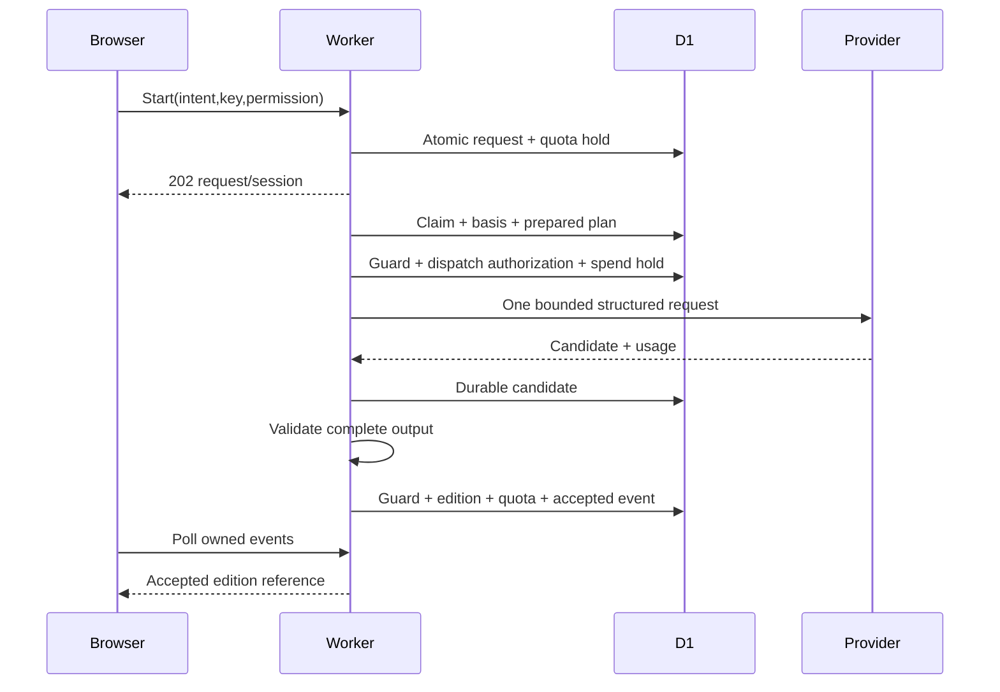

# Generation, concurrency, composition and accounting

This is a specification of algorithms and transaction boundaries, not executed application code. Names and states match DOMAIN_CONTRACTS and schema.sql. Primary D1 is authoritative. Worker memory is disposable. No shared in-memory lock, browser connection, scheduler acknowledgement or provider response creates publication authority.

## Identities, versions and duplication

`clientIntentId` is a UUID generated when the browser starts a draft. Keep this non-content ID in sessionStorage until the request resolves; after reload `/requests?intentId=…` resolves it. An explicit “New session” creates a new intent. Double-clicks, reconnects and HTTP retries keep the same intent and Idempotency-Key. Concurrent distinct keys for the same intent join the existing request when canonical payload HMAC matches; attach both keys to it. A changed payload under either key or intent returns 409 IDEMPOTENCY_MISMATCH. An intentional new intent with identical question is a new draw and consumes quota if accepted; do not deduplicate private questions globally.

Idempotency-Key is 16–128 ASCII characters, client random, stored as HMAC; expires after seven days, except the unique intent remains as long as its request tombstone. Canonical payload is RFC 8785/JCS of parsed input, route operation and authenticated subject, including exact selected offsets/preview hashes and permission revision. HMAC with a domain-separated stable account index key prevents dictionary attacks on private hashes. Same key on a different operation conflicts. Keys for reflection/import/deletion actions reference the committed result; resolve only after current ownership checks. An expired key does not authorize duplicating an existing intent.

Reading editions are immutable accepted artifacts. Initial publication is edition 1; a follow-up creates the next edition in the **same session**, under a new logical request, pointing to its exact parent edition. It reuses that session's tarot basis; it never redraws. Limit 50 follow-ups/session. Parent must be an accepted tarot edition, not a legacy unknown method. Imported text may be separately granted and selected for a new tarot session. The initial question lives on the session; each edition retains its own follow-up question. Neither automatically carries old reflection text forward.

`revision` is CAS state version; `run_epoch` is a monotonic lease fence; `edition_number` is user-visible historical sequence; reflection revisions are authored content versions; permission revisions change egress policy; content policy revisions invalidate withdrawal races; key versions fence encryption. None is a substitute for another. DB schema/user payload/content/prompt/validator/model identities are independently recorded in the plan and accepted provenance.

## Durable state machine

All transitions use a single D1 batch containing guard assertions, state mutation, revision increment and event insertion. An assertion inserts `0` into `assertion_probe(ok CHECK(ok=1))` on a false predicate. A conditional UPDATE affecting zero rows is not sufficient: immediately assert `changes() = expected`, inside the batch. FK/UNIQUE/CHECK failures abort it. Catch expected fence failures, reread primary state and return the actual outcome; never treat them as successful updates.

| From → to | Actor / guards and durable writes | Deadline, retry and compensation |
|---|---|---|
| absent → reserved | HTTP service: authenticated active account, permission enabled, input admission, content approved/cleared, ≤2 active/account, quotas available. Insert session if initial, request/input, both quota holds/events, key mapping, QUEUED event. | ≤1 s target. Duplicate unique conflict rereads/join. Reservation expires with request at +180 s. |
| reserved → prepared | Driver claims epoch/token; constructs draw/basis or copies parent reference, builds complete plan and snapshots selected context, checks preview hashes and budget. Guard current state/keys/permission/content. | Lease 30 s, ≤3 local epochs. Before any dispatch it is safe to repeat local computation, but a committed basis is reused. Failure → blocked/failed with quota release. |
| prepared → dispatching | Driver's dispatch batch verifies the same eligibility predicates as publication, state prepared, current source revisions; creates the **unique** dispatch row, exact encrypted payload, spend reservations and WRITING event. | 18 s external timeout; no remote retry. Commit is dispatch authorization's linearization point. |
| dispatching → received | Driver with current token records encrypted bounded raw candidate, usage/provider identity, cost reconciliation and CHECKING event. | May retry this DB-only write within lease if response remains in memory. No second provider call. |
| received → validating | Driver reads durable candidate, marks validating. | Local validation ≤250 ms CPU target, 64 KiB response cap. Crash can revalidate saved response in a new local epoch. |
| validating → published | Accepted candidate plus current publication guard and complete publication transaction below. | Publication retry reads DB; if already published return same edition. Retry DB-only up to remaining lease/epochs, never generate again. |
| dispatching → uncertain | Timeout, connection lost, crash after authorization or lost candidate. Mark dispatch unknown and conservatively settle maximum reserved provider cost. | Never resend. If still eligible and before deadline → fallback_pending; otherwise terminalize. A late provider response cannot change a published template. |
| prepared/dispatching/validating → fallback_pending | Only enumerated failure categories below; prepared path covers a known provider outage. Persist reason; retain same complete plan. | Same guards as ordinary publication; deterministic validation must pass. No fresh model call. |
| fallback_pending → published | Driver creates deterministic result, validates template and invokes publication guard. | Template releases product quota; actual/uncertain provider cost is retained. |
| any nonterminal → cancelled | Owner cancel with CAS (or deleting account/source invalidation service). Increment revision/run_epoch, clear lease; release held quota once; STOPPED event. | Immediate DB fence. Abort local fetch best effort; remote execution may continue. |
| any nonterminal → blocked | Current permission/source/key/account/input/content eligibility lost, sensitive or unsupported input, invalid mandatory plan. | No template. Release product quota; retain provider cost. Exact error determines whether new user action is required. |
| any nonterminal → expired | Cron at absolute deadline (or local driver before transition); fence run and release quota. | No authorization at or beyond the database-clock deadline; no automatic new request. |
| any nonterminal → failed | Nonrecoverable internal failure, three local attempts exhausted, or deterministic template fails. | Release held quota once; alert aggregate error. |

Nonterminal includes `uncertain`; terminal states are `published,cancelled,expired,blocked,failed`. Polling may briefly show uncertain while deciding a template, never “failed” followed silently by success. Terminal success cannot transition back; later content withdrawal/deletion changes edition availability rather than rewriting request success. Delivered is a client observation, not a new generation state. The accepted event and GET suffice; lost delivery does not refund or regenerate.

Cron runs each minute, scans due indexed rows (20/run), claims at most four concurrently, skips leases not expired, and ends within 50 s wall / 25 s CPU. If overlapping Cron or fast wakes occur, CAS wins one lease. A pre-dispatch expired lease can be reclaimed; any existing dispatch authorization suppresses another external call. At most three local epochs, then fail/expire. Missed scheduler invocations are detected by oldest due age; scheduler reliability is a launch proof, not an assumption of exact delivery. Backlog admission returns 503 with Retry-After when oldest queued age >60 s or 100 pending requests globally.

## Transaction assertions and critical pseudocode

Deadline eligibility uses `CAST(unixepoch('subsec') * 1000 AS INTEGER)` **inside the authoritative SQL statement**, with strict `lease_expires_at > database_now` and `expires_at > database_now`. Equality is expired. A bound Worker timestamp is never authority, even if sampled immediately before `batch()`. [SQLite's date/time contract](https://www.sqlite.org/lang_datefunc.html) provides subsecond Unix time and a consistent current-time value within a statement. Qualify this expression in the pinned workerd/D1 runtime; a missing/null clock fails closed. Worker clocks may drive polling and abort timers only.

For both dispatch and publication, execute the eligibility assertion immediately before the authorization state update in the same transaction; assert the update's row count. Earlier inserts/reservations roll back if the final assertion fails. That execution-time check is the deadline boundary. It does not promise that commit visibility, the HTTP acknowledgement or the already-authorized external call occurs before the deadline. A delayed batch starting after expiry cannot authorize; a lost/late acknowledgement still requires reading authoritative state. Derive admission expiry and lease creation/renewal from the same database clock, and repeat deadline predicates on the authorization update so time crossing between statements also rejects the update.

`guardCurrent` means the predicates in [publication_guard.sql](publication_guard.sql), with the expected stage substituted as described below; it is **inside** the write batch. It checks account status/write fence/current key, current permission, parent and basis, every selected grant/source, plan identity, content policy and release eligibility, run token/lease/deadline, and configured provider policy. Captured context_count must equal the actual snapshot row count and the validated plan selection count; fragment_hmac values must match the locally validated plan in ordinal order. Parent/selected native reading content must also remain eligible even when the new request uses a newer content edition. For prepare/start, the missing basis/plan checks are replaced by validation of the captured source versions and input. For dispatch the permitted state is exactly `prepared`; the plan/basis/source clauses are identical. Dispatch additionally requires system_state.dispatch_mode=model. outage_template permits only the enumerated OUTAGE template; off denies new work with DEPENDENCY_UNAVAILABLE or SPEND_LIMIT. generation_enabled=0 is a full publication/admission kill switch. No caller-provided SQL or field names.

```
start(principal, key, input):
  parse closed input; check Origin/CSRF/session; normalize surrounding question whitespace
  run local input language/topic admission; return non-reading error before storage/provider on disallowed input
  primary read key and intent; if found: current owner check, compare canonical payload HMAC, return join
  load current permission, content, parent, exact source revisions; decrypt selected text only
  require preview HMAC and grant versions match; plan cannot silently drop selection
  generate IDs and encrypt input with current DEK; no provider/network operation
  batch:
    assert current active account, key, permission, source versions, content and limits match reads
    ensure UTC day/month quota buckets with fixed allowances 3/30
    increment each bucket held if held+consumed<allowance; assert changes()=2
    insert initial session (or assert owned parent session open/saved)
    insert request reserved, reservation held, quota event reserve, event QUEUED, idempotency key
    increment account.data_revision and storage counter by actual ciphertext byte delta
  on uniqueness race: reread and compare payload; roll back losing quota increments automatically
  schedule ctx.waitUntil(drive(requestId)); return 202 IDs (never candidate)

drive/dispatch(requestId):
  batch CAS-claim eligible due request; increment run_epoch; lease=database_now+30s; create attempt
  if any dispatch exists: recover durable response/uncertainty; NEVER call writer again
  construct/restore basis, complete prepared plan, prompt projection; persist with guard
  bound all bytes/tokens and validate input/topic/content; required overflow -> blocked INPUT_TOO_LARGE
  batch dispatch guard(expected=prepared):
    reserve worst-case $0.04 in UTC day/month spend buckets; assert both within ceilings
    assert global active dispatch count <10 and no prior dispatch
    insert provider_dispatches authorized with exact encrypted request bytes + HMAC
    insert cost_reservation
    repeat dispatch guard immediately before state update, using the database execution clock
    update request dispatching WHERE both deadlines > database_now; assert changes()=1; event WRITING
  immediately call provider once, no SDK retry, redirects disabled, hard 18s abort
  classify transport response; bounded decrypt/validate of received data is local
  persist received response + usage with same fence; reconcile cost even if candidate rejected
  if request lost fence, discard private candidate and perform only content-free cost reconciliation
  validate or enter eligible fallback; complete/publish

complete/publish(request, candidateOrTemplate):
  if primary request is published: authorize owner and return existing edition
  locally validate complete artifact; encrypt reading with the observed current key version
  batch:
    assert artifact IDs, plan HMAC and key version agree with request (local validated values bound)
    insert edition with UNIQUE(request_id), next MAX(edition_number)+1 scoped to owned session
    assert quota reservation is held
    update reservation to consumed for model, released for template; assert changes()=1
    decrement held in original day/month buckets; increment consumed only for model; assert changes()=2
    insert unique quota consume/release event
    execute publication_guard.sql with :expected_state validating OR fallback_pending
    update request published, finished_at=database_now, clear lease, revision++
      WHERE both deadlines > database_now; assert changes()=1
    insert ACCEPTED event with next_event; increment next_event and account.data_revision/storage_bytes
  on uncertain DB response: reread primary by request_id; retry only if not published and fence still live
  return only after committed batch; HTTP disconnect has no effect on accepted record

cancel(principal, requestId, expectedRevision):
  batch assert owner, active session, exact revision; if published return conflict with editionId
    assert nonterminal; state=cancelled, run_epoch++, revision++, lease=NULL
    release held quota with CAS and unique release event (no second release if already terminal)
    event STOPPED/CANCELLED; erase private pending material via deletion queue if requested
  abort in-process fetch best effort; do not refund incurred/unknown provider cost

recover(now):
  for due rows ordered next_run_at,id, limit20:
    expired -> atomic terminalize and release
    live lease -> skip
    no dispatch -> claim next epoch and prepare/dispatch if attempts<3
    dispatch + durable candidate -> claim next epoch, revalidate and publish if current
    dispatch + no durable candidate -> unknown cost, uncertain state, eligible template or terminal
  also reconcile deletion jobs, remove expired keys/events/challenges, alert on overdue erasure
```

All loops are bounded. A statement's `changes()` assertion is directly after that statement; intervening event inserts would invalidate that check. Conditional mutations must expect exactly one request/reservation or exactly two distinct quota periods. Period keys are prefixed `day:YYYY-MM-DD` / `month:YYYY-MM`; they cannot collapse into one key. Every statement uses ≤100 bound parameters and batches target ≤40 statements. No explicit SQL BEGIN/COMMIT over separate Worker calls. No provider callback endpoint exists; unsolicited or duplicate callbacks have no authority. Durable response processing can be repeated, publication cannot.

D1 application wait budget5s per binding call; a timed-out await does not cancel the database operation. Treat write acknowledgement as unknown and resolve by operation identity/primary reads, not a fresh mutation. Before dispatch authorization the fast driver requires≥21s remaining (18s provider plus3s receipt/publication allowance); otherwise release its lease with prepared state and schedule recovery. R2 binding operations use a5s wait budget, then read the immutable key before retry; absent/unknown does not authorize success. Conditional-create duplicates compare exact bytes and use≥1s backoff per same key to respect R2 contention limits. Security/deletion sagas use their longer Cron recovery schedule; no new session or successful deletion acceptance on an uncertain ledger write.

**Revocation boundary:** a DB transaction and a third-party HTTPS transmission cannot be atomic. The last eligibility check commits immediately before dispatch. A revocation committed before dispatch authorization prevents egress. A revocation after authorization is treated as potentially already transmitted, even if actual socket bytes follow it; abort best effort and always recheck before publication. The UI states this explicitly. Never claim a zero-width physical race or exactly-once provider execution. One dispatch record establishes at-most-one deliberate call by this application, not the provider's internal execution count.

**Quota versus cost:** reserve product quota at start; release on all non-success and templates; consume once for accepted model output. Original UTC buckets receive compensation even across midnight/month boundaries. `quota_reservations.state` CAS plus unique events are authoritative; events alone never calculate billing. Spend reserves 40,000 microUSD ($0.04), then reduces committed totals only by a known unused amount when token usage is available or a verified no-execution rejection occurred. Uncertain outcomes keep the full ceiling; provider reconciliation can append an audited adjustment, never infer zero from timeout. Known cost = input×$2/1M + output×$12/1M rounded up to microdollars; all output including any billable internal tokens counts. No price change activates without policy hash and revised maximum reservation. If actual reported cost exceeds reserved, stop further dispatches, alert and record actual separately; do not truncate the provider liability to the application cap.

## Sequence cases



```mermaid
sequenceDiagram
 participant B as Two browser sends
 participant W as Worker instances
 participant D as D1
 B->>W: Same intent, same payload
 W->>D: Competing reservation batches
 D-->>W: One commits; other UNIQUE failure rolls back
 W->>D: Read winning intent and payload HMAC
 W-->>B: Both join identical request
 Note over W,D: Changed payload returns 409; no new quota hold
```

```mermaid
sequenceDiagram
 participant U as User
 participant W as Driver
 participant D as D1
 participant P as Provider
 W->>D: Dispatch authorization checks grant revision 4
 W->>P: Selected excerpt may leave
 U->>D: Revoke grant; revision 5; fence affected requests
 P-->>W: Candidate
 W->>D: Publication assertion expects grant revision 4
 D-->>W: CHECK failure; whole publication rolls back
 W-->>U: Context changed; no accepted reading; quota released
 Note over U,P: Revocation cannot retract already transmitted text
```

```mermaid
sequenceDiagram
 participant W as Driver
 participant D as D1
 participant P as Provider
 participant C as Recovery Cron
 W->>D: Unique dispatch + maximum spend reservation
 W->>P: Request
 Note over W,P: Response lost or worker exits
 C->>D: Expired lease; dispatch exists without durable response
 C->>D: Mark unknown cost; never re-dispatch
 C->>C: Compose validated template if eligible
 C->>D: Current guard + template publication + quota release
 Note over C,D: Cancel/revoke/deletion/expiry instead terminalizes without fallback
```

## Tarot basis and prepared plan

Deck identity is a content-hashed ordered list of 78 `major-00..21`, `suit-01..14` card IDs. Major ordering explicitly follows RWS Strength VIII, Justice XI. Suit rank 11 Page, 12 Knight, 13 Queen, 14 King. Names/imagery are content edition metadata; images are optional. Three positions are `situation,tension,possibility`, not past/present/future predictions. Reversals are a user toggle, default off; when on each orientation has independent probability 1/2.

Draw algorithm `hmac-sha256-fisher-yates-reject.v1`: generate 32 bytes using Worker `crypto.getRandomValues`; fail closed if unavailable. Derive a deterministic byte stream by HMAC-SHA256(seed, UTF8(`reflection.draw.v1`) || uint64be(counter)), counter starts 0. Consume uint32be values. For Fisher–Yates i=77 down to1, accept u < floor(2^32/(i+1))×(i+1), swap index i with u mod(i+1). Take first three. If reversals enabled, consume three additional words, odd means reversed. Store seed, algorithm, deck hash, full card bindings/counts and timestamp encrypted **before** dispatch. Seed is not derived from question, gestures or current time. No client can choose production seed. Tests can inject seed in a local-only domain function.

Replay guarantees the ordered draw and orientations for that algorithm/deck, not model text, semantic truth, fairness proof to a third party, or results under changed content. Saved basis is authoritative even if a future algorithm is removed. Hash/version changed without changing stored basis does not rewrite history. Compute four suit counts from drawn minor cards; majors contribute no suit. Each card fact ID binds one position and card/orientation; count IDs bind suit. IDs cannot be repurposed between plans.

One `PreparedPlan` includes all seven fact IDs, three selected exact canon entries, question, language, operation/parent, selected fragments and consent/key/content/prompt/validator/policy identities. Choose each card+orientation source with exact position override if approved, else the approved position-neutral entry. Never invent a source or silently change orientation to obtain text. Missing canon → CONTENT_UNAVAILABLE, not a model guess. Completed v1 canon needs 78×2 neutral entries and three position framing templates; optional overrides follow the same review gate.

Both prompt composition and deterministic composition consume this same plan. Deterministic text is approved source `fallbackText` plus code-rendered card/position/orientation and the approved question. No stitching of arbitrary selected private text into templates. Follow-up templates state they provide another reflection prompt based on the original draw; they do not pretend to answer a nuanced follow-up personally.

## Egress and prompt budget

Allowed payload: fixed system/developer instructions; code-rendered seven facts and position mapping; three selected source texts and opaque local fact/source labels; current trimmed question; explicitly previewed selected text with authorship labels; schema and writing constraints. Excluded: account/session/request IDs, seed, credential/email/device/network identifiers, raw import documents, unselected history, raw birth input, diagnostics, owner secrets and other accounts. Provider correlation uses a random per-dispatch ID only if needed; it is not an account identifier. No tool execution, retrieval, browsing, provider conversation IDs or `previous_response_id`.

Question ≤500 characters; ≤3 fragments, each ≤1200 Unicode code points, aggregate ≤3000; three canon inputs ≤1200 each. Serializer has ≤28 KiB UTF-8 payload bound and local model-specific token estimate ceiling 8,000, including instructions/schema framing. Freeze tokenizer/version and test conservative estimate against returned usage. Mandatory facts, selected sources and disclosures are never truncated. Deterministic order: instructions → required facts → selected source entries → current question → explicit selected fragments → schema. Reject oversized input before reservation where calculable; later exact overflow blocks and releases. Show what to shorten; never silently omit selected context. Optional stylistic examples are absent in v1. Raw text is JSON string data with delimiter instructions, not executable markup or commands.

OpenAI Responses: `model:gpt-5.6-terra`, `reasoning:{effort:'none'}`, `max_output_tokens:1600`, `store:false`, strict `text.format` from ModelCandidate with sourceIds item enum narrowed to the three selected source IDs, no tools, no streaming, SDK maxRetries=0 or direct fetch. Treat provider refusals/incomplete output as separate envelopes before attempting JSON parse. Record requested and returned model, parameters, token counts, elapsed time, response ID encrypted, price basis, policy/content/prompt/validator hashes, dispatch uncertainty. No private text in logs. Alias-only snapshot documentation means requalification/release freeze on observed behavior change; byte-identical inference is not promised.

## Validation guarantee and limits

Order: (1) 64 KiB byte/JSON depth≤12 and schema; (2) closed supplied entities/source IDs and exact three distinct positions; (3) card/orientation/source binding and count recomputation; (4) technical assertion separation; (5) supported relation and personal-claim heuristics; (6) language/topic handling; (7) repetition/readability bounds; (8) current publication guard. Bound tokenization to 4,000 words, 100 sentences, 30 entity mentions, 250 ms CPU; limits fail with a code, never skip validation. No network/model call inside any validator.

Default precise facts are **code-rendered sentences** adjacent to generated interpretation. Model fields cannot assert card names, orientation, positions as factual clauses, numbers/counts, astrology calculations or timing. Plain references such as “this image” and nontechnical metaphors are allowed. Explicit entity aliases are parsed against the closed deck lexicon with sentence spans; quotations, negations, comparisons and conditional statements are marked before assertion checks. Numeric reflection instructions such as “write two options” are permitted in questions; “two Cups are drawn” must come from the count renderer. No universal placeholder grammar is used: `{{…}}` and unresolved template markers are invalid output. HTML/Markdown links are never rendered; all text uses escaped React text nodes.

Mechanical checks prove identity, inclusion, count and binding of structured fields and code-rendered values. They do **not** prove that an interpretation follows from a tradition, that cited text supports an arbitrary relationship, or that a personal claim is true. Heuristic analyzer splits clauses, tags tense/modal/subject/attribution, and applies versioned categories rather than adding one regex per observed bad string. Flag direct user biography (“you were abandoned”, “you are hiding debt”), future certainties (“you will be offered a new role”), diagnoses, prescriptive medical/legal/financial advice, causal certainty and ungrounded relational claims. Valid selected user quotations are attributed as user statements, never converted to asserted fact. Conditional invitations (“if this fits, consider…”) are allowed only without embedded asserted biography.

Heuristic uncertain → candidate rejected for this request; no second model judge or quality repair. A false positive can produce a clearly labeled safe template, and is assessed offline against must-accept fixtures; it cannot silently lower publication safeguards. Repetition checks: same normalized sentence twice within output rejects; cross-follow-up comparison uses only explicitly selected prior output, otherwise no automatic history inspection. Low stylistic variety alone is tracked in synthetic evaluation, not a reason to re-call a model.

Fallback reasons are **only** `OUTAGE` (documented unreachable/429/5xx/configured outage mode), `MALFORMED` (bad/incomplete JSON), `VALIDATION` (candidate rejected while the input/plan itself remains eligible), `TIMEOUT_UNKNOWN` (uncertain external completion). A credential misconfiguration is an operational failure; approved outage template may be offered with provenance, but never silently treated as a working provider. Provider refusal → PROVIDER_REFUSAL non-reading, no template bypass. Input sensitive/crisis/unsupported language, no consent, revoked source, invalidated basis, withdrawn content, cancelled/deleted/frozen account, key fence, missing required facts or expired request → **no ordinary reading**. Templates pass content/schema/binding/language checks and the identical current-state guard. Display “Prepared reflection template” rather than “AI reading”.

Compare controlled fact sentences against (a) structured relation assertions rendered in code and (b) per-field placeholders in the offline experiment. Current choice is settled provisionally as controlled sentences, not “tokens everywhere pending a decision”. Experiment, overturn conditions and affected contracts are in VERIFICATION_PLAN; coding starts now, editorial/provider launch waits for qualification.

## Later astrology adapter boundary

Only domain contracts and fixture tests ship in v1; no calculation service is deployed. Latitude is geodetic north-positive; longitude east-positive; decimal degrees. Input uses explicit Gregorian local civil date/time, IANA zone and offset/fold. Reject nonexistent DST time; ambiguous time needs earlier/later selection. Unknown time is an interval over the full local day, not noon treated as exact. Approximate input uses a user-declared interval. Calculation service records engine/binding/ephemeris/tzdb versions and hashes, UTC conversion, coordinate convention and calculation ID. No geocoding service is introduced; a later UI must explicitly select coordinates/zone.

Later qualification compares endpoint/interval samples and adaptively refines near sign/aspect/house transitions. Suppress houses/angles for unknown time; suppress any Moon sign or aspect that changes over the interval. Do not present uncertain orbs as precise. Aspect facts identify both body facts and angular relationship, not just two valid tokens. A transit window is startsAt/exactAt/endsAt with referenceAt, resolution and applying/exact/separating/indeterminate phase; multiple exact hits are separate facts. Duration is end−start at declared resolution; relative “tomorrow” is code-rendered in chosen user zone and anchored to stored referenceAt, never regenerated from the current clock. Code renders uncertainty disclosures from reliability flags. Licensing and golden-case gates must pass before this adapter becomes an enabled method.

Cost reconciliation is an atomic CAS operation: read cost state/amount, assert unchanged, insert unique cost_adjustments.idempotency_key (dispatch+reconciliation receipt identity), update actual/unknown state and both spend buckets by the unused reserved difference, assert expected row counts. Duplicate adjustment returns stored result. Actual liability above reserved is always recorded in cost_reservations.actual_microusd and cost_adjustments; set generation_enabled=0 and retain admission bucket at its ceiling if the excess cannot fit, rather than rejecting the cost receipt or pretending cost equals the cap. No cost write may restore deleted owner/dispatch linkage. Restore terminalizes all nonterminal work and freezes financial admission as specified in SECURITY_RESTORE; the normal recover algorithm never runs on a restored DB before that procedure.

The generated model-output.schema.json is the static shape. At plan preparation, replace only sourceIds.items with the closed three-source enum (and hash that instantiated schema into the prompt/dispatch receipt). Fact IDs are the seven closed TarotFactId values. Local validation also enforces each unit cites its own card-position fact exactly once and its selected source, with optional same-suit count facts; all seven mandatory facts remain in the code-rendered basis panel even if a prose unit does not cite every count. Public source snapshots are embedded in AcceptedReading.sources for exact historical basis inspection, subject to withdrawal/redaction.
