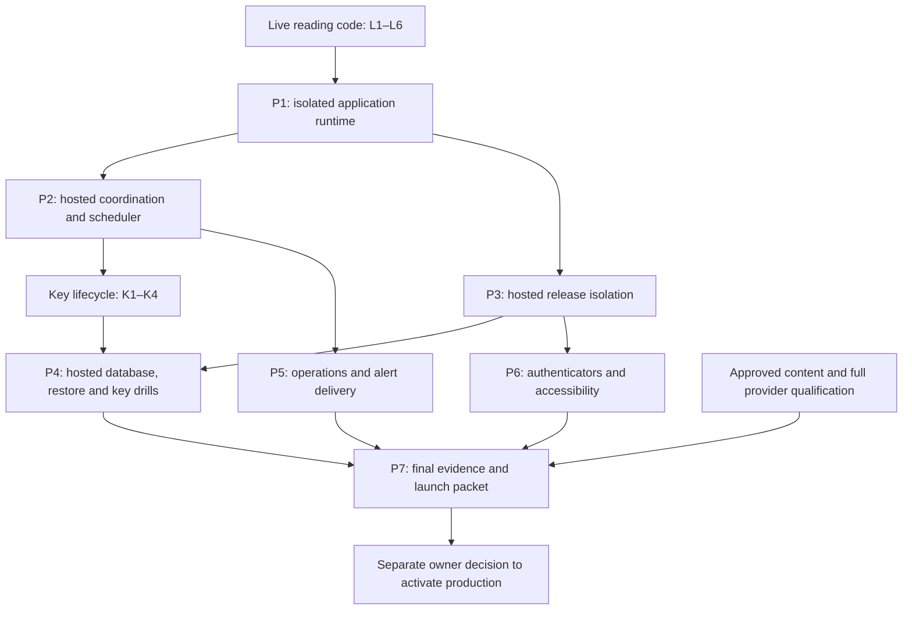

# Production Qualification Implementation Plan

> **For agentic workers:** REQUIRED SUB-SKILL: Use superpowers:subagent-driven-development (recommended) or superpowers:executing-plans to implement this plan task-by-task. Steps use checkbox (`- [ ]`) syntax for tracking.

**Goal:** Produce the implementation and genuine hosted/automated evidence needed to qualify the existing MVP for real use, then present a concrete launch decision.

**Architecture:** Keep the established Workers/D1/R2 design, with explicitly isolated local, hosted-synthetic and production runtimes. Qualify one final source candidate through controlled synthetic deployment, independent recovery storage, bounded scheduler work, automated identity and accessibility checks with explicit physical-device limitations. Evidence is content-free, integrity-checked and bound to exact source/configuration hashes; production activation remains a separate action.

**Tech Stack:** Existing TypeScript/Hono/React/Vite, Cloudflare Workers/D1/R2, a narrowly scoped Durable Object for hosted offline coordination, Cloudflare Workers Builds as the proposed hosted pipeline, Vitest and Playwright.

**Spec:** [Production gates](../../PRODUCTION_ACCEPTANCE.md), [verification requirements](../../architecture/VERIFICATION_PLAN.md), [security/restore](../../architecture/SECURITY_RESTORE.md), [operations runbook](../../OPERATIONS_RUNBOOK.md), and the owner's 2026-10-27 request to plan live AI readings and production qualification. Companion implementation plans: [GPT-6.1 Terra readings](2026-10-27-live-ai-readings.md) and [key lifecycle](2026-10-27-production-key-lifecycle.md).

## Execution status — 2026-10-28

Implementation began from merged main `6b9b1fc`. P1/P2 and companion K1–K4 are implemented and locally verified. P3 guarded build/content tooling, P4 private scenario orchestration and P5 heartbeat/monitoring preparation are implemented; their actual hosted procedures remain pending isolated accounts, target configuration and operational choices. P6 local Chromium journeys include 320px reflow, doubled rendered text and semantic/focus checks, with physical/screen-reader limitations. P7's concrete [release packet](../../LAUNCH_DECISION.md) records the remaining dependencies. All ten external gates remain pending; production activation is disabled. Checkboxes below preserve the full qualification procedures and do not imply unrun hosted steps are complete.

## Global Constraints

- Baseline `main` at `a553695`; all ten entries in `qualification/acceptance.json` are pending. Source/test-definition review is not new executed acceptance.
- Node `26.12.1`, the checked-in lockfile and Worker compatibility date `2026-10-23` remain the starting runtime. Qualify any required upgrade separately.
- `npm run verify` retains its `540-second` deadline and rejects skipped/flaky/failed evidence. Its scope remains local; hosted/automated receipts have separate scopes.
- Keep `npm run release -- --check` non-deploying and `deploymentAllowed:false`. Verified gates do not themselves grant deployment authorization.
- Before real private persistence or application provider egress, satisfy the applicable identity/privacy/content/provider/release/database/restore/accessibility/operations/owner gates. Synthetic staging and bounded evaluation have separate, explicit authority.
- Preserve all implemented account/reading/save/history/reflection/privacy workflows and the fixed cursor behavior. Milestone 3 remains deferred.
- Never install public synthetic keys in hosted environments or reuse production resources, encryption keys, recovery stores or provider tokens in previews.
- One durable request, at most one provider dispatch and at most one accepted publication. `waitUntil`, Cron acknowledgement and process memory provide no publication authority.
- Restore resets model/context permissions, cancels restored unfinished generation and freezes financial admission. Do not regain allowance/spend capacity by restoring an older database.
- Production journal bodies, recovery factors, provider text, ciphertext and account/request identifiers stay out of telemetry and public qualification records.

## Review Focus

- Missing/expired provider qualification must leave owned saved-record actions usable; P1 tests generation-only failures separately from identity failures.
- A restored database must not roll back the outer offline fence or revive a stale writer; P2/P4 test independent coordination and storage loss.
- Preview code may change its own branch checks; P3 proves isolation through actual credential/resource restrictions.
- Missed/overlapping scheduler wakes and process death must not duplicate calls or silently starve erasure/security work; P2/P5 test the deployed runtime.
- Screens that pass browser automation may still fail physical/synced passkeys or screen-reader announcements; P6 records these unverified limitations. The owner excludes human-review sign-offs.

---

## Work sequence and approval points

Local implementation, synthetic tests, review packets and dry-run configuration can proceed before owner launch decisions. Complete each concrete change/package before requesting approval for its external step. The owner subsequently approved implementation and the existing development-preview smoke. Broader paid evaluations, new hosted resources, external notifications and production activation require concrete target/budget instructions. Launch geography, minimum age and human-review sign-offs are excluded by owner instruction.

| Decision needed | Prepare first | Needed before |
| --- | --- | --- |
| Stable production origin/RP ID | Proposed origin/resource manifest, support matrix, copy/rights constraints | Hosted-domain qualification and final content/owner acceptance |
| Evaluation project/settings and spend authority | L5/L7 exact corpus, call schedule, retention and cost ceiling | First paid evaluation call |
| Hosting account/region, resources, secrets and budget | P1/P3 rendered configuration, permission scopes, expected costs and isolation checks | Provisioning/deploying synthetic qualification environment |
| Source provenance and automated validator identity | L3 exact hash-bound review packet | Approved content activation and provider qualification |
| Operators, alert destination, backup custody and targets | P4/P5 runbooks and a concrete synthetic alert/drill | Sending an alert and closing operations/restore gates |
| Production launch | P7 completed evidence, known limitations, rollback and monitoring packet | Enabling production admission/dispatch |

The repository's `$10/day`, `$100/month`, `$40` evaluation caps and backup windows are technical baselines, not inferred owner choices. Lower authorized limits take precedence. Do not ask for every decision now; collect it when the dependent result is reviewable.

## Gate-to-evidence map

| Existing gate ID | Work owner | Required evidence scope and decisive result |
| --- | --- | --- |
| `identity` | P1/P6 | `hosted-synthetic`: exact origin/RP ID; automated passkey journeys with physical/synced limitations; same-account complete-kit recovery and unchanged saved reading |
| `keys` | K1–K4/P4 | `hosted-synthetic`: secret custody, resumable rekey/rewrap, retained receipts, complete inventory, safe retirement and key-loss refusal |
| `content` | L3 | `automated-review`: exact launch sources, positions, fallbacks, product/privacy copy, provenance and attribution validated by the named automated runner; signed artifact retains unknown rights |
| `provider` | Deferred full qualification, original L7 scope | `provider-evaluation`: GPT-6.1 Terra project/privacy settings, frozen corpus, automated quality scores with runner/version, bounded latency/tokens, actual cost reconciliation |
| `release` | P3 | `hosted-synthetic`: failed main build blocks release, non-main production attempt rejected, preview credentials cannot access production markers |
| `database` | P2/P4 | `hosted-synthetic`: actual D1 rollback/races, overlap/missed Cron, crash recovery, no duplicate publication/quota/call |
| `restore` | P4 | `hosted-synthetic`: stale snapshot replay preserves erasure/factor/code/permission/spend fences; independent loss stays offline; measured RPO/RTO |
| `accessibility` | P6 | `automated-review`: recorded automated browser matrix, keyboard, semantic tree, focus, 320px and doubled text/layout, interruption/conflict states; VoiceOver/NVDA and physical devices remain untested limitations |
| `operations` | P5 | `hosted-synthetic`: observed heartbeat and missing-heartbeat detection, received/acknowledged synthetic alerts, named incident owner, recovery practice |
| `owner` | P7 | `owner-decision`: recorded domain, budgets and operational responsibility |

Preserve these existing gate IDs and scopes. Local test reports cannot be substituted for any of them.

## P1 — Assemble explicit local, qualification and production runtimes

**Files:** Create `src/worker/runtime/config.ts`, `src/worker/runtime/application.ts`, `tests/domain/runtime-config.test.ts`, `tests/db/runtime-boundaries.test.ts`, `scripts/render-hosted-config.ts`. Modify `src/worker/index.ts`, `src/worker/identity/routes.ts`, `src/worker/readings/routes.ts`, `scripts/verification-environment.ts`, `tests/tooling/environment.test.ts` and `scripts/package.ts`. Check in nonsecret templates under `config/`; do not invent resource IDs or commit rendered credentials.

**Interfaces:** `RuntimeManifest` declares `mode:'synthetic-local'|'hosted-synthetic'|'production'`, immutable `environmentId`, exact `origin`, `rpId`, resource identities, policy/content identities, `generation:'off'|'intercepted'|'qualified'` and the qualified evidence digest. `createRuntime(env: RuntimeBindings, fetcher?: typeof fetch): Promise<ApplicationRuntime>` returns `{identity: IdentityService; base: RecordBase; generation: ReadingGeneration; environmentId: string}`. `RuntimeBindings` extends existing D1/R2/asset bindings with the manifest and separate server-only identity/provider secret bindings. Reject unknown/partial identity/resource combinations. Construct generation even when disabled using an explicit rejecting writer and readiness guard, so cancellation, status and conservative terminalization/cleanup still work without credentials.

- [ ] Test local-only localhost/public test keys; production HTTPS/exact RP ID/environment matching; shared-resource rejection; provider key absence/expiry; and default-disabled dispatch. Assert `/me`, history, reflection, export and delete remain usable when only generation prerequisites fail, and maintenance can still terminalize pending work without network access or resetting unknown liability.
- [ ] Run `npm run test:domain -- tests/domain/runtime-config.test.ts tests/tooling/environment.test.ts` and `npm run test:db -- tests/db/runtime-boundaries.test.ts`; observe intended failures.
- [ ] Build the runtime factory once per request/scheduled invocation. Preserve `localIdentity` behavior for explicit local fixtures through a compatibility wrapper; hosted routes use the configured identity factory. Remove localhost assumptions only from the new hosted branch. Keep strict origin, CSRF, cookie, owner and restore guards intact.
- [ ] Wire L6's shared generation service and make `/health` report the actual content-free mode/readiness rather than always claiming milestone 1/synthetic-only. Provider qualification is not required to construct record-only services. No frontend bundle, logging path or error message may include server secret material.
- [ ] Render reviewable preview/qualification/production configs with distinct D1/R2/coordinator identities and secrets. Production config starts with ingress/admission/dispatch off. Keep checked-in local configurations local. Extend packaging for nonsecret `config/` templates and test archive source-digest equality.
- [ ] Run affected integrated browser and runtime tests and typecheck; commit this boundary before any hosted provisioning.

## P2 — Implement hosted offline coordination and bounded scheduled recovery

**Files:** Create `src/worker/recovery/hosted-coordinator.ts`, `src/worker/recovery/backup-inventory.ts`, `src/worker/maintenance/driver.ts`, `src/worker/db/migrations/0012_hosted_coordination.sql`, `tests/db/offline-coordination.test.ts`, `tests/db/maintenance-driver.test.ts`. Modify `src/worker/recovery/coordination.ts`, `src/worker/identity/checkpoint.ts`, `src/worker/readings/erasure.ts`, `src/worker/recovery/restore.ts`, `src/worker/recovery/cleanup.ts`, `src/worker/db/column-registry.json`, `src/worker/index.ts` and hosted configuration templates. The migration follows L4's `0011` and precedes K2's `0013`; renumber consistently if another migration lands first.

**Interfaces:** Define `OfflineContext={environmentId:string; operationId:string; epoch:number; purpose:'restore'|'cleanup'|'rekey'|'retirement'}`. `OfflineCoordinator` exposes `acquire(purpose, environmentId):Promise<OfflineContext>`, `assertCurrent(context):Promise<void>`, and `complete(context, evidenceHash):Promise<void>`. Completing an operator lease does not enable ingress or generation. A separate authenticated resume operation requires validated recovery evidence. `withRecoveryWriter<T>(environmentId, work):Promise<T>` registers/drains normal recovery-store writers against the same coordinator.

`BackupInventory.list():Promise<BackupManifest[]>` and `verify(manifest):Promise<boolean>` use an independent store. Each protected manifest binds environment, snapshot/object digest, creation/expiry, kind (`d1`, `recovery`, `offline-keys`), recovery epoch, required environment-key IDs and required account-DEK versions. Manifests can contain private operational identity and therefore are not public qualification evidence. Public reports contain only counts/digests/times. Absence of the independent inventory is a failure, not proof of no backups.

`runMaintenance(runtime: ApplicationRuntime, budget: {deadlineMs:number; concurrency:4}):Promise<MaintenanceSummary>` calls the existing generation, identity, erasure and retention services in bounded slices and exposes counts/oldest ages only.

- [ ] Add tests using independent coordinator instances: overlapping operators, normal writers draining before restore, loss of lease, stale operator after a new epoch, database rollback to an older epoch, delayed R2 writes, missing inventory and interrupted cleanup. An in-memory `Map` must not establish hosted exclusion.
- [ ] Add scheduler tests with overlapping/missed wakes, fresh Worker instances and backlog pressure. Assert no redispatch of authorized work, no starvation of security/erasure maintenance, original quota buckets and deterministic expiry/release.
- [ ] Run `npm run test:db -- tests/db/offline-coordination.test.ts tests/db/maintenance-driver.test.ts` and confirm failures.
- [ ] Implement one Durable Object per environment for the **offline control state**, independent of the database being restored. Its persistent epoch and authenticated operator identity fence ingress, scheduled writers and recovery operations. Keep application publication/dispatch authority in D1. Integrate writer registration and persistent epoch/CAS checks on mutations; do not treat an expired writer heartbeat alone as proof the writer stopped. Failure to establish quiescence leaves maintenance closed.
- [ ] Port local restore/cleanup service dependencies to explicit runtime/content/inventory/coordinator interfaces. Preserve local wrappers and their receipts; hosted receipts use `hosted-synthetic`. Remove hard-coded `syntheticBundle` recovery assumptions only in the shared implementation. Every restore reestablishes D1's offline fence under the independent coordinator before replay.
- [ ] Configure one-minute Cron wakes and a shared bounded driver. Initial HTTP `waitUntil` is a latency optimization; durable work is recoverable without it. The driver budget is the active provider deadline plus `30s` (`90s` for the current policy), with four concurrent generation slots. The hosted request awaits initial generation; a `60s` provider call cannot depend on the `30s` post-response extension. Start inference only when it fits the remaining budget; expired work terminalizes instead of consuming repeated inference. Capacity remains governed by D1 reservations, not the number of Cron invocations.
- [ ] Run relevant lifecycle/checkpoint/restore/cleanup tests and typecheck; commit. A real multi-isolate/crash test on deployed synthetic resources remains P4 evidence.

Cloudflare documents a `30s` extension for HTTP `waitUntil` after the response/disconnect, so it is not a durable job guarantee. [Worker duration limits](https://developers.cloudflare.com/workers/platform/limits/#duration). Cron runs through the scheduled handler; awaiting its returned promise covers its work. [Scheduled handlers](https://developers.cloudflare.com/workers/runtime-apis/handlers/scheduled/).

## P3 — Enforce and demonstrate hosted release isolation

**Files:** Create `scripts/hosted-release.ts`, `tests/tooling/hosted-release.test.ts`, `docs/HOSTED_RELEASE_RUNBOOK.md`. Modify `scripts/release.ts`, `scripts/qualification.ts`, `scripts/package.ts`, `tests/tooling/release.test.ts`, `tests/tooling/qualification.test.ts` and the hosted templates.

**Interfaces:** `checkHostedCandidate(input: {trustedBranch:string; commit:string; applicationDigest:string; environmentManifest:RuntimeManifest; verification:unknown}): HostedReleaseCheck` validates the exact artifact and trusted build context. `HostedReleaseCheck` distinguishes `syntheticQualificationAllowed` from `productionActivationAllowed`; the latter remains false without completed gates **and** a separate reviewed launch authorization. Branch identity comes from the authenticated build context and protected deployment credential policy, not a user-supplied HTTP parameter.

- [ ] Add tests rejecting stale/missing local receipts, wrong source/artifact/configuration digest, non-main production target, target/resource mix-ups and attempts to use a synthetic qualification receipt as production approval. Keep current `release --check` non-deploying.
- [ ] Run `npm run test:domain -- tests/tooling/hosted-release.test.ts tests/tooling/release.test.ts tests/tooling/qualification.test.ts` and demonstrate the new failures.
- [ ] Prepare a Workers Builds configuration with pinned Node/browser setup, full `npm run verify`, artifact hashing and the guarded deploy command. Use separate production and preview credentials/resources; use separate accounts if actual token scoping cannot enforce that boundary. A different Worker name alone is not isolation. Review the concrete config/cost/permissions before provisioning.
- [ ] After authorization, deploy only the synthetic qualification target. Record an actual controlled failing main build that cannot promote, a rejected non-main production attempt, and preview attempts to access synthetic production markers. Exercise credentials directly so bypassing a repo script cannot bypass the resource boundary. Capture the actual build identity and resource/tokens scope without secret values.
- [ ] Restore the passing candidate, record clean-cache gate duration and browser setup, and rerun the real hosted build. If Workers Builds cannot meet enforcement or the runtime gate, record a pipeline decision and requalify a suitable hosted runner; do not quietly substitute local execution or assume GitHub Actions is available.
- [ ] Commit tooling and observed evidence separately. No real-user rollout occurs in this step.

Workers Builds supports custom build/deploy commands and configurable tokens; its default token permissions must be inspected and restricted for this design. [Build configuration](https://developers.cloudflare.com/workers/ci-cd/builds/configuration/).

## P4 — Prove hosted database, backup, restore and key behavior

**Files:** Create `scripts/hosted-qualify.ts`, `scripts/hosted-restore.ts`, `docs/HOSTED_RESTORE_RUNBOOK.md`, `tests/tooling/hosted-qualification.test.ts`. Extend `tests/db/generation-recovery.test.ts`, `tests/db/privacy-restore.test.ts` and the existing erasure/checkpoint tests where shared service regressions are needed. Real evidence belongs in `qualification/evidence/`.

**Interfaces:** `runHostedQualification(target: VerifiedHostedTarget, scenario: HostedScenario): Promise<HostedScenarioReceipt>` is an operator-only runner with explicit target allowlisting. Define scenarios `batch-rollback`, `request-races`, `scheduler-crash`, `stale-restore`, `recovery-loss`, `key-lifecycle`. `VerifiedHostedTarget` is derived from P3's approved environment manifest, not a database ID accepted without validation. Content-free receipts include source/config hashes, scenario, procedure, actual observed assertions, start/end times and limitations.

- [ ] Test the runner refusing production data targets, missing authorization/manifest, unrecognized resource identity and incomplete evidence. Run the targeted tooling test before implementing the runner.
- [ ] On authorized hosted synthetic D1, force a mid-publication statement failure and verify rollback of reading/evidence/quota/events. Exercise duplicate Start, cancellation/revocation/deletion/key-change versus dispatch/publication, expired lease and lost acknowledgement. Assert one publication and compensated original quota buckets. Use the normal primary D1 path; do not introduce unconstrained replicas for privacy/publication guards.
- [ ] Exercise actual Cron overlap/missed wake, process termination before dispatch, after authorization before fetch, after response and after durable candidate. Use an isolated controllable provider stub with an external call counter for crash schedules; do not inject faults into the paid provider. The receipt must distinguish stub protocol evidence from L7 live inference evidence.
- [ ] Provision independent backup inventory, retained secrets and recovery objects. Document the actual restore window and any exported/offline copies; verify capture, restore and key dependencies for every supported backup class. Compare measured RPO/RTO to owner-accepted targets; record the target before running the drill.
- [ ] Execute the stale-bookmark drill: save a synthetic marker, snapshot, remove a passkey, consume a recovery code, revoke AI permission, delete the marker and retain its receipt; include a pre-dispatch request. With ingress/egress independently disabled, restore, replay security/erasure and assert marker absent everywhere, factor/code rejected, consent off, no redispatch and spend frozen. Account for unavailable data within RPO honestly.
- [ ] Repeat with absent/corrupt recovery objects, missing manifest, partial list, missing retained key and backup inventory loss; all remain offline. Repeat restore after completed deletion and interrupted cleanup to prove new erasure passes/deadlines do not shorten retention.
- [ ] Run K1–K4 against hosted synthetic records with provisioned test secrets: wrap rotation, full DEK replacement, current-checkpoint rollover, interrupted resume, legitimate retirement and rejection of still-referenced keys. Prove exact saved content, recovery-kit identity and deletion receipt verification survive. Record restricted secret access and separate protected secret backups.
- [ ] Validate actual evidence for `database`, `restore` and `keys`. Update final gate records only through P7 after the source candidate is frozen.

Cloudflare documents D1 batch rollback when a statement fails; this supports the design but does not substitute for exercising the actual application batch and deployment. [D1 batch API](https://developers.cloudflare.com/d1/worker-api/d1-database/#batch).

## P5 — Connect content-free monitoring and rehearse operator response

**Files:** Modify `src/worker/maintenance/health.ts`, `src/worker/maintenance/driver.ts`, `docs/OPERATIONS_RUNBOOK.md`, and `tests/db/maintenance-health.test.ts`. Create `scripts/monitoring-check.ts`, `docs/HOSTED_OPERATIONS.md`, `tests/tooling/monitoring.test.ts`; store reviewed monitoring configuration with the nonsecret hosted templates.

**Interfaces:** Extend `MaintenanceSummary` with run completion time, bounded work counts and queue ages; retain aggregate cost/liability fields. `checkHeartbeat(lastCompletedAt: number | null, now: number, expectedIntervalMs:60000): 'healthy'|'missing'` marks missing after three expected intervals as a proposed initial alert policy. The external monitor must detect absence independently of the Worker whose failure it reports.

- [ ] Test successful heartbeat, three missed wakes, security backlog older than `5min`, erasure lag older than `24h`, unfinished generation `>=100` or oldest `>60s`, unknown provider cost and spend-limit disablement. Assert emitted events contain no private markers, URLs with capabilities, secret values, raw exceptions or user identifiers.
- [ ] Run the targeted monitoring/tooling tests, then implement the content-free monitor configuration and the synthetic `--dry-run` check. Explicitly disable automatic request/response-body tracing and review platform invocation log fields/retention.
- [ ] Prepare the exact synthetic notification and recipient/channel configuration. Obtain explicit instruction before sending any external alert. Prove delivery, operator acknowledgement, loss-of-heartbeat detection and recovery on the hosted target; a local log entry is insufficient.
- [ ] Record named primary/backup operators, incident access, provider kill switch, deletion-delay handling, secret recovery and backup retrieval procedures. Generation-disablement must preserve history/reflection/export/deletion when their dependencies remain safe; no rollback restores obsolete data or wipes financial liability.
- [ ] Rehearse incident disable/recover and missing-key/restore failure handling using P4 fixtures. Record accepted response targets and observed times; review the `operations` gate evidence.

## P6 — Verify automated identity and accessibility journeys

**Files:** Extend browser tests and prepare content-free records under `qualification/evidence/`; update `docs/PRODUCTION_ACCEPTANCE.md`.

**Consumes:** P1 exact origin/RP ID, P3 hosted synthetic artifact and validated product copy. **Produces:** Automated evidence for `identity` and `accessibility`, with browser versions, runner identity and explicit limitations. The owner excludes human reviewers, launch-country requirements and minimum-age policy.

- [ ] Run automated passkey registration, additional-factor reauthentication/add/remove, last-factor/ten-factor protections, logout-all and lost-browser recovery from the downloaded kit. Reopen identical saved content with no extra generation; reject removed factors and spent codes.
- [ ] Verify keyboard navigation, completion focus, progress/cancel/reload, content-role semantics, optional Save/reflection, history, conflict/offline behavior, consent-off export and exact-revision deletion.
- [ ] Verify 320px layouts, 200% zoom/text and accessibility-tree semantics in the supported automated browser matrix. Record actual versions and assertions.
- [ ] Record physical/synchronized authenticators and VoiceOver/NVDA experience as untested limitations. Automation does not establish those results, and human sign-off is not a release gate.

## P7 — Freeze final evidence and present a launch decision

**Files:** Update `qualification/acceptance.json`, add final records in `qualification/evidence/`, and write `docs/LAUNCH_DECISION.md` before the final source freeze. Modify delivery/acceptance prose only where actual results supersede pending claims; preserve historical reports.

**Consumes:** All ten gate results and the owner's decisions. **Produces:** A reviewed release candidate with `milestone2Complete:true` only when every required gate is genuinely verified, a deployment-disabled release check, and a separate concrete activation packet.

- [ ] Finish all code/config/copy/runbook/plan changes, freeze a candidate and run `npm run verify`. Compute `qualificationDigest` using the existing checker; it excludes `qualification/` to avoid circular evidence hashes but includes other source/docs/config bytes. Never hand-edit a verification receipt.
- [ ] For each gate, record actual procedure/environment/result/limitations, runner identity/date, correct scope, final application digest and evidence-byte SHA-256. Evidence from an earlier source version requires a documented impact review and rerun of affected checks; merely replacing its digest is not requalification.
- [ ] Run `npm run release -- --check`. Require zero pending gates and valid evidence integrity; verify it still returns `deploymentAllowed:false`. Recording gate changes alters the full local source digest, so rerun `npm run verify` after the final evidence update before the last release check/package. This does not change `qualificationDigest` because its evidence directory is excluded.
- [ ] Prepare the launch packet: exact domain/RP ID, validated content and 6.1 Terra policy, target resources/secret versions, budgets/admission policy, privacy copy, named operators, monitoring, restore/key-recovery evidence, known limitations and rollback procedure. Do not infer an invite-only pilot unless its admission control was implemented and tested.
- [ ] Present the exact staged artifact/configuration and activation steps for the owner's separate launch decision. The eventual activation should change only the reviewed admission/dispatch controls; if it requires new code, freeze and qualify that code first. Rollback disables generation/admission and preserves safe owned-record access and financial/erasure records.
- [ ] After explicit launch authorization, the executor may enable the reviewed production target and verify limited synthetic smoke journeys plus aggregate monitoring within the authorized budget. Expansion requires the measured latency/fallback/cost/support behavior to meet the accepted operating limits. This plan does not itself perform or authorize those actions.

## Planning validation and handoff

These plans deliberately reuse implemented UI and database lifecycle behavior. They do not mark a test or production gate passed, inspect a delivered ZIP, or certify any ignored execution receipt. Planning changes are documentation only; the full verification suite is an implementation/release step, not evidence generated by writing this plan. Because documentation is included in `sourceDigest`, existing receipts must be regenerated before a new release/package after these files are added.

Recommended execution is sequential native work, starting with L1/L2, with independent review at the completed implementation boundary. The provider/core/key interfaces are tightly coupled, so concurrent implementation offers limited benefit. The owner approved native implementation. Paid evaluation, hosted provisioning and production activation still require their separate concrete authorizations.
